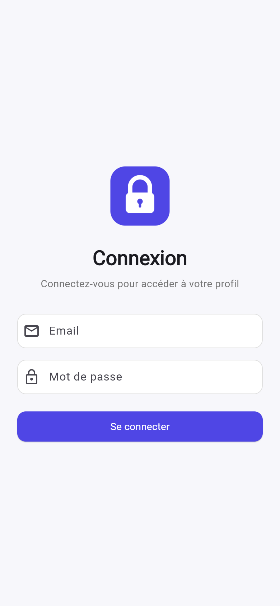
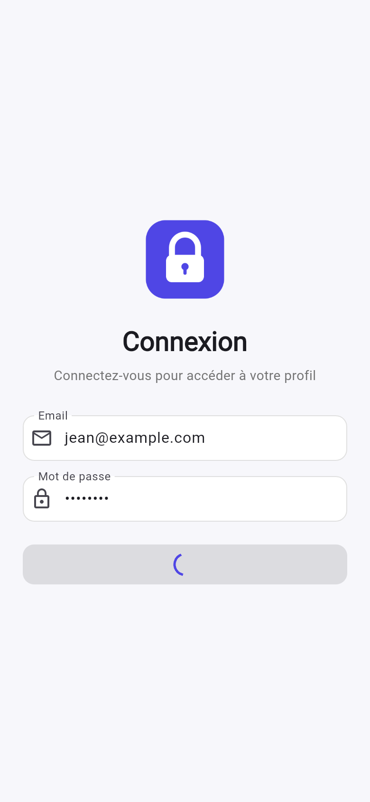
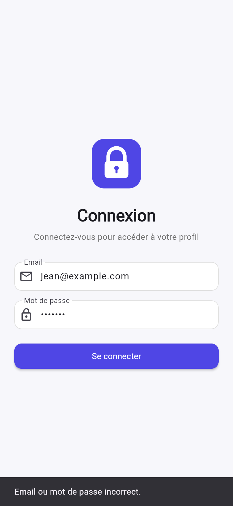
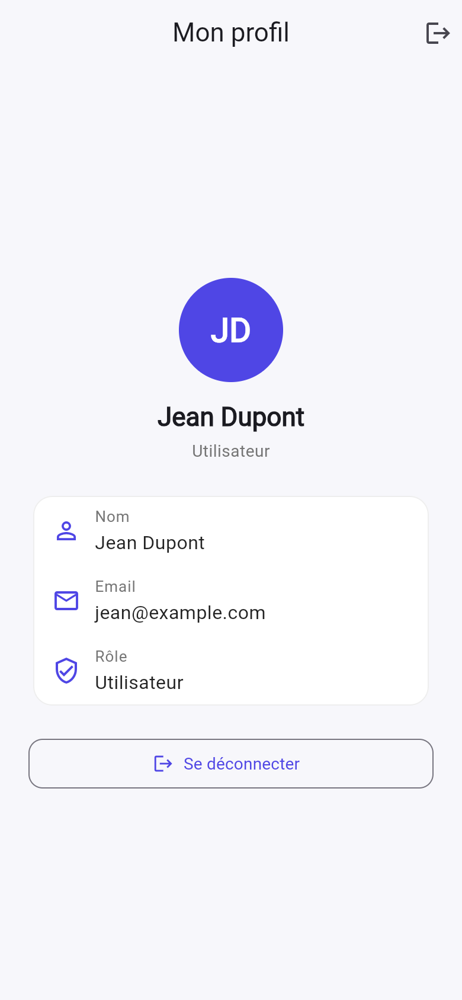

# Login App Plus — Authentification Flutter via API REST

Application Flutter de connexion qui s'authentifie auprès d'une **API REST** (NestJS / TypeScript) au lieu d'un tableau local.
L'API vérifie les mots de passe hachés avec **bcrypt**, renvoie le profil en JSON et délivre un **token JWT** stocké de façon sécurisée sur l'appareil.

## Fonctionnalités

**Application Flutter**
- Connexion via `POST /login` avec le package `http` (async/await, timeout, gestion des erreurs réseau, serveur et identifiants)
- Affichage du profil connecté (nom, email, rôle, identifiant)
- Token stocké avec `flutter_secure_storage` et **session restaurée automatiquement** au démarrage (`GET /me`)
- Gestion d'état avec **Provider** (`AuthProvider`)
- UX/UI : `CircularProgressIndicator` dans le bouton pendant la connexion (transition `AnimatedSwitcher`), `SingleChildScrollView` + largeur max (clavier ouvert, paysage, tablette, web), messages d'erreur en `SnackBar`, thème personnalisé (couleur, champs et boutons arrondis), logo en image (`assets/images/logo.png`)

**API (Option A — API personnelle, NestJS)**
- Architecture NestJS en modules : `UsersModule`, `AuthModule` (contrôleur, service, DTO, guard)
- `POST /login` (alias `/login.php`) : accepte `email` et `password` en form-urlencoded ou JSON
- Mots de passe **hachés et salés avec bcrypt** (coût 12), jamais stockés en clair
- Validation des entrées avec un DTO `class-validator` (format de l'email, longueurs, champs inconnus refusés, JSON invalide)
- Toutes les erreurs au même format `{ status, message }` (filtre d'exceptions global)
- Protection contre le brute-force avec `@nestjs/throttler` (20 tentatives / 15 min / IP)
- Temps de réponse constant que l'email existe ou non (pas d'énumération des comptes)
- En-têtes de sécurité (`helmet`), CORS, taille des requêtes limitée
- Token **JWT** (`@nestjs/jwt`, 1 h) et route protégée `GET /me` (`JwtAuthGuard`)
- HTTPS : directement (certificat via `.env`) ou via l'hébergeur
- Tests e2e Jest + Supertest (`npm test`)

## Structure du projet

```
login_app_plus/
├── lib/
│   ├── main.dart                 # Point d'entrée, Provider
│   ├── config/api_config.dart    # URL de l'API, endpoints, timeout
│   ├── models/
│   │   ├── user.dart             # Modèle User (fromJson, rôle, initiales)
│   │   └── auth_exception.dart   # Erreurs d'authentification typées
│   ├── providers/auth_provider.dart  # État d'authentification (ChangeNotifier)
│   ├── services/
│   │   ├── auth_service.dart     # Appels HTTP à l'API
│   │   └── token_storage.dart    # Stockage sécurisé du token
│   ├── screens/
│   │   ├── splash_screen.dart    # Restauration de session
│   │   ├── login_screen.dart     # Formulaire de connexion
│   │   └── profile_screen.dart   # Profil de l'utilisateur
│   └── widgets/profile_info_tile.dart  # Ligne d'info du profil
├── assets/images/logo.png        # Logo de l'application
├── test/widget_test.dart         # Tests (modèle, service, provider, écran)
└── api/                              # API REST NestJS
    ├── src/
    │   ├── main.ts                   # Démarrage HTTP / HTTPS
    │   ├── setup-app.ts              # Helmet, CORS, validation, filtre d'erreurs
    │   ├── app.module.ts             # Module racine (config, throttler)
    │   ├── app.controller.ts         # GET / et GET /health
    │   ├── auth/
    │   │   ├── auth.module.ts        # Configuration JWT
    │   │   ├── auth.controller.ts    # POST /login, GET /me
    │   │   ├── auth.service.ts       # Vérification bcrypt, génération du token
    │   │   ├── dto/login.dto.ts      # Validation des entrées
    │   │   └── guards/jwt-auth.guard.ts
    │   ├── users/
    │   │   ├── users.module.ts
    │   │   ├── users.service.ts
    │   │   ├── user.entity.ts
    │   │   └── data/users.json       # Utilisateurs (mots de passe hachés)
    │   └── common/filters/http-exception.filter.ts
    ├── scripts/hash-password.ts      # Génère un hachage bcrypt
    └── test/auth.e2e-spec.ts
```

## Identifiants de test

| Email               | Mot de passe | Rôle                |
|---------------------|--------------|---------------------|
| jean@example.com    | userpass     | 2 — Utilisateur     |
| julie@example.com   | adminpass    | 1 — Administrateur  |

## Lancer l'API

Prérequis : Node.js 20 ou plus.

```bash
cd api
npm install
cp .env.example .env      # puis remplacer JWT_SECRET par une valeur aléatoire
npm run build
npm start                 # http://localhost:3000
```

En développement (rechargement automatique) : `npm run start:dev`.

Tests de l'API :

```bash
npm test
```

Test manuel :

```bash
curl -X POST http://localhost:3000/login -d email=jean@example.com -d password=userpass
```

Ajouter un utilisateur : générer le hachage avec `npm run hash -- "motDePasse"` puis l'ajouter dans `src/users/data/users.json`.

### Contrat de l'API

`POST /login` — paramètres `email`, `password`

Succès (HTTP 200) :
```json
{
  "status": 200,
  "message": "Success",
  "id": 1,
  "firstName": "Jean",
  "lastName": "Dupont",
  "email": "jean@example.com",
  "role": 2,
  "token": "eyJhbGciOi..."
}
```

Erreur (HTTP 400) :
```json
{ "status": 400, "message": "Error" }
```

`GET /me` — en-tête `Authorization: Bearer <token>` → profil (200) ou `{"status":401,"message":"Unauthorized"}`.

### HTTPS / déploiement

Les mots de passe doivent transiter en HTTPS. Deux possibilités :
- **Hébergeur** (Render, Railway, VPS derrière Nginx + Let's Encrypt…) : il fournit le HTTPS, l'API tourne en HTTP derrière. Sur Render : *Root Directory* `api`, *Build* `npm install && npm run build`, *Start* `npm start`, et définir `JWT_SECRET` dans les variables d'environnement.
- **Certificat direct** : renseigner `SSL_KEY_PATH` et `SSL_CERT_PATH` dans `.env`.

En local, l'app utilise HTTP uniquement en mode debug (`usesCleartextTraffic` limité au manifest debug Android, `NSAllowsLocalNetworking` sur iOS).

## Lancer l'application Flutter

Prérequis : Flutter 3.35+ (Dart 3.9).

```bash
flutter pub get
flutter run
```

URL de l'API utilisée par défaut :
- émulateur Android : `http://10.0.2.2:3000`
- iOS / web / desktop : `http://localhost:3000`

Pour une autre URL (API déployée en HTTPS, téléphone physique…) :

```bash
flutter run --dart-define=API_URL=https://mon-api.onrender.com
```

L'app est aussi compatible avec l'API PHP fournie (`--dart-define=API_URL=https://temp.itds.fr` cible `/login`. Pour `/login_tst_local.php`, adapter `loginUri` dans `lib/config/api_config.dart`).

Tests Flutter :

```bash
flutter analyze
flutter test
```

## Captures d'écran

<!-- Ajouter ici les captures : écran de connexion, chargement, erreur, profil -->

| Connexion | Chargement | Erreur | Profil |
|-----------|------------|--------|--------|
|  |  |  |  |
